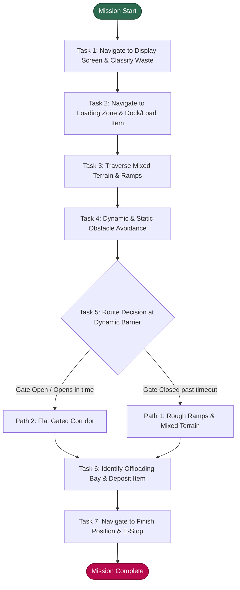
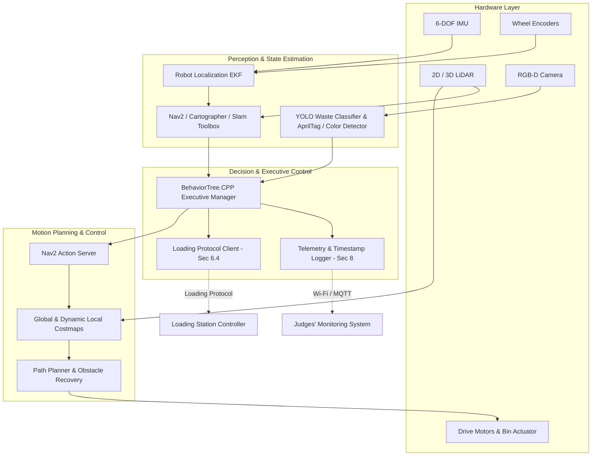

# Robotics Dojo 2026 (RDJ 2026) Autonomous Mission Software Engineering Brief
**Document Version:** 1.0  
**Source Rulebook:** `RuleBook_RDJ_2026_V0.9 (1).pdf` (Organizing Committee: Robotics Dojo at JKUAT)  
**Target Audience:** Autonomous Robot Software Architecture, SLAM, Perception, and Motion Planning Teams  

---

## 1. Autonomous Run: Exact Sequence of Tasks & Physical Actions

The competition unfolds in two distinct 3-minute phases (**Section 1**): a **3-minute Mapping Phase** followed immediately by a **3-minute Autonomous Task Phase**. During the autonomous phase, the robot must execute the mission sequence strictly without human intervention (**Section 5.2, Section 6.2, Section 8.3**).

The mission pipeline follows the sequence established in **Section 4 (Figure 3: Waste Management Flow Diagram)**, **Section 5.2 (Autonomous Phase)**, and **Section 8 (Page 12, Figure 4: Expected Data)**:



### Step-by-Step Task Breakdown

#### Step 0: Autonomous Launch & Initialization
* **Source:** Section 2.6, Section 5.2, Section 6.2, Section 8 (Page 12).
* **Physical Action:** The robot starts motionless inside the designated start position at the bottom-right corner of the arena. Upon start signal, the robot initializes its onboard state machine, enables localization against the pre-built map, starts its internal mission clock, and records `Autonomous start time` (**Section 8 / Page 12**).
* **Success Criteria:** Initiates motion without human touch or remote triggering (**Section 6.2, Section 8.3**).

#### Step 1: Waste Detection & Classification
* **Source:** Section 3.5, Section 5.2, Section 7.a, Section 8 (Page 12).
* **Physical Action:**
  1. The robot navigates from the start zone to the designated display screen.
  2. Points its onboard vision sensor (RGB camera) at the screen.
  3. Classifies the waste type shown on the display. According to **Section 5.2**, the waste types are:
     * `plastic`
     * `metal`
     * `organic`  
     *(See Ambiguities section regarding Figure 6 showing fabric)*.
  4. Stores the target waste category into memory and transmits/logs `Waste detection time` (**Section 8 / Page 12**).
* **Success Criteria:**
  * Clean navigation to screen (Scored up to 3 points, **Section 7.a**).
  * Accurate classification of displayed waste (Scored up to 6 points, **Section 7.a**).
  * Rapid detection speed (Scored up to 6 points, **Section 7.a**; sample telemetry benchmark is `12.4 s`, **Figure 4**).

#### Step 2: Loading Operation
* **Source:** Section 3.5, Section 5.2, Section 6.4, Section 7.a, Section 8 (Page 12).
* **Physical Action:**
  1. Robot navigates autonomously to the loading station corresponding to the detected waste type (**Section 5.2**).
  2. Aligns and docks with the loading station fixture.
  3. Implements the specified communication protocol to coordinate item loading (**Section 6.4**).
  4. Actuates onboarding mechanism or receives item into onboard containment container; secures item so it will not dislodge during rough transit (**Section 7.a**).
  5. Records and transmits `Loading completion time` (**Section 8 / Page 12**; sample telemetry benchmark `31.8 s`).
* **Success Criteria:**
  * Correct loading station selection corresponding to detected waste (4 points, **Section 7.a**).
  * Precise docking/positioning at station (3 points, **Section 7.a**).
  * Item firmly secured without drop (3 points, **Section 7.a**).

#### Step 3: Mixed Terrain & Ramp Navigation
* **Source:** Section 2.1, Section 3.2, Section 5.2, Section 7.a, Section 8 (Page 12).
* **Physical Action:**
  1. Robot navigates toward the offloading area across the designated terrain section.
  2. Traverses ramps (both ascending incline and descending decline) and heterogeneous ground surfaces: gravel, grater (metal grating/mesh), ramp and sand, and grass (**Section 2.1, Section 5.2, Section 7.a**).
  3. Robot chassis, drive train, and suspension must maintain traction and balance without rolling over, bottoming out, or shedding its payload.
  4. Records `Terrain completion time` (**Section 8 / Page 12**; sample telemetry benchmark `58.2 s`).
* **Success Criteria:** Full traversal across gravel, sand, ramps, grass, and grater without getting stuck, losing payload, or requiring human touch (15 points, **Section 7.a**).

#### Step 4: Obstacle Avoidance (Judges' Cylinders & Dynamic Obstacles)
* **Source:** Section 2.3, Section 3.4, Section 5.2, Section 7.a, Section 8 (Page 12).
* **Physical Action:**
  1. Detects randomly placed static cylinders placed by judges (**Section 2.3, Section 3.4**) and dynamic obstacles placed at random locations along the route representing workers (**Section 5.2**).
  2. If an obstacle blocks the robot's planned trajectory, the robot's local trajectory planner must dynamically evaluate whether to come to a temporary stop and wait for a moving dynamic obstacle to clear, or generate an online collision-free detour (**Section 5.2**).
  3. Strict zero-contact policy: "No collisions permitted" (**Section 5.2**).
  4. Records `Obstacle detection/response time` (**Section 8 / Page 12**; sample telemetry benchmark `1:12.5`).
* **Success Criteria:**
  * Reliable obstacle detection via onboard LiDAR/depth sensors (6 points, **Section 7.a**).
  * Flawless avoidance / appropriate waiting response with zero collisions (6 points, **Section 7.a**).
  * High path efficiency without excessive wandering (3 points, **Section 7.a**).

#### Step 5: Route Decision (Dynamic Time-Based Gate Barrier)
* **Source:** Section 2.2, Section 3.3, Section 5.2, Section 7.a, Section 7.c, Section 8 (Page 12).
* **Physical Action:**
  1. At the path junction, the robot must choose between two distinct routes (**Section 5.2, Section 7.c**):
     * **Path 1:** Ramps and mixed terrain; *always open / available*.
     * **Path 2:** Flat, obstacle-free route with a dynamic mechanical gate; *periodically closed*.
  2. Robot navigates to the gate checkpoint and inspects the gate status (**Section 7.c**).
  3. **Decision Logic (**Section 7.c**):**
     * If Path 2's gate is open, or opens within the "standard waiting time", the robot waits and traverses Path 2.
     * If Path 2's gate is closed and does *not* open within the "standard waiting time", the robot aborts Path 2 and reroutes through Path 1.
  4. Records `Gate decision time` and `Gate waiting time` (**Section 8 / Page 12**; sample telemetry benchmark `1:35.7`).
* **Success Criteria:**
  * Making the optimal decision (waiting for open gate or diverting when shut past threshold): 10 points (**Section 7.c**; or 6 pts gate decision + 4 pts time efficiency in **Section 7.a**).
  * An inefficient decision (e.g. unnecessarily taking the longer rough route when Path 2 was open): 5 points (**Section 7.c**).
  * Failure to make decision or complete route: 0 points (**Section 7.c**).

#### Step 6: Offloading / Sorting Bay Deposit
* **Source:** Section 2.5, Section 3.5, Section 5.2, Section 7.a, Section 8 (Page 12).
* **Physical Action:**
  1. Navigates to the offloading zone containing colour-coded stations (**Section 2.5**).
  2. Detects and identifies the target offloading station by color corresponding to the classified waste (**Section 5.2**):
     * `Blue` $\rightarrow$ `plastic`
     * `White` $\rightarrow$ `organic`
     * `Black` $\rightarrow$ `metal`  
     *(See Ambiguities section regarding conflict with page 6 graphic showing Green/Blue/Red)*.
  3. Robot aligns with the target bin and actuates its manipulator/dispenser to deposit the waste cleanly into the bin interior.
  4. Records `Depositing completion time` (**Section 8 / Page 12**; sample telemetry benchmark `2:18.4`).
* **Success Criteria:**
  * Accurate color detection (5 points, **Section 7.a**).
  * Correct bin selection matching the Step 1 item (5 points, **Section 7.a**).
  * Placement precision without dropping outside the bin (3 points, **Section 7.a**).

#### Step 7: Finish Position & Autonomous Halt
* **Source:** Section 3.6, Section 5.2, Section 7.a, Section 7.i, Section 8 (Page 12).
* **Physical Action:**
  1. Following successful deposit, robot maneuvers to the designated finish position (**Section 5.2**).
  2. Brings the vehicle to a complete, controlled standstill inside the finish zone.
  3. Engages autonomous stopping mechanism (**Section 7.i**).
  4. Records `Finish time` and `Total autonomous run time` (**Section 8 / Page 12**; sample telemetry benchmark `2:41.6`).
* **Success Criteria:**
  * Reaching finish position (2 points within Depositing breakdown, **Section 7.a**).
  * Compliant stopping mechanism actuation (2 points, **Section 7.i**).
  * Total mission time under the 3-minute (180 s) limit (**Section 3.6, Section 5.2**), qualifying for Finish Time Performance points (up to 3 points, **Section 7.a/b/i**).

---

## 2. Complete Scoring Table & Penalty Architecture

### A. Autonomous On-Field Task Scoring (90 Points Subtotal — Section 7.a)

| Task | Category Points | Sub-Criteria & Point Distribution | Rulebook Reference |
| :--- | :---: | :--- | :--- |
| **Mapping** | **10** | Completeness of area coverage (5 pts)<br>Accuracy and usability for autonomous navigation (5 pts) | Section 5.1, 7.a |
| **Waste Detection** | **15** | Classification accuracy (6 pts)<br>Detection speed (6 pts)<br>Navigation to display screen (3 pts) | Section 5.2, 7.a |
| **Terrain Navigation** | **15** | Successful negotiation of gravel, sand, ramps, grass, and grater (15 pts) | Section 2.1, 5.2, 7.a |
| **Obstacle Avoidance** | **15** | Obstacle detection (6 pts)<br>Avoidance / response behavior (6 pts)<br>Path efficiency (3 pts) | Section 5.2, 7.a |
| **Loading Operation** | **10** | Correct station selection (4 pts)<br>Docking / positioning accuracy (3 pts)<br>Item securement (3 pts) | Section 5.2, 7.a |
| **Route Decision** | **10** | Gate decision logic (6 pts)<br>Time efficiency (4 pts)<br>*(Graded as: Correct = 10 pts, Inefficient = 5 pts, Failure = 0 pts)* | Section 7.a, 7.c |
| **Depositing / Sorting** | **15** | Offloading color detection (5 pts)<br>Bin selection (5 pts)<br>Placement precision (3 pts)<br>Reaching finish position (2 pts) | Section 5.2, 7.a |
| **TASK SUBTOTAL** | **90** | **Total available from autonomous on-field operations** | **Section 7.a, 7.i** |

### B. Speed & Finish Performance (3 Points — Section 7.a, 7.b, 7.i)

| Performance Tier | Points | Qualification Standard |
| :--- | :---: | :--- |
| **Maximum** | **3** | Finishes fastest among competing robots |
| **Average** | **2** | Meets the average standard finish time |
| **Minimum** | **1** | Meets the minimum standard finish time |
| **Does not finish** | **0** | Fails to reach finish position within the 3-minute task phase |

> [!NOTE]
> **Performance Grading Rule (Section 7.b):**
> * Maximum performance = Full available points (100%)
> * Average performance = 2/3 of available points
> * Minimum performance = 1/3 of available points
> * Failed = 0 points  
> *"Exact time limits will be announced before the competition."*

### C. Technical, Simulation & Bonus Evaluations (72 Points — Section 7.d, 7.e, 7.f, 7.g, 7.i)

| Evaluation Category | Max Points | Evaluation Breakdown & Requirements | Rulebook Reference |
| :--- | :---: | :--- | :--- |
| **Stopping Mechanism** | **2** | Verification of robot's compliant stopping / e-stop mechanism | Section 7.i |
| **Virtual SLAM** | **10** | Map completeness (4 pts)<br>Map accuracy (3 pts)<br>Navigation readiness (3 pts)<br>*(Assessed in virtual simulation environment)* | Section 7.f, 7.g, 7.i |
| **CAD Design & Presentation** | **10** | CAD model quality (3 pts)<br>Design justification & mechanism selection (3 pts)<br>Technical presentation (2 pts)<br>STEP file submission & screenshots (2 pts) | Section 7.g, 7.i |
| **Technical Report** | **10** | Technical content, methodology, experimental results, and conclusions | Section 7.g, 7.i |
| **Poster Presentation** | **10** | Technical clarity (4 pts)<br>Visual organization (3 pts)<br>Problem framing (3 pts) | Section 7.g, 7.i |
| **Industrial Scalability** | **10** | Manufacturability (4 pts)<br>Cost-effectiveness (3 pts)<br>Deployment feasibility (3 pts) | Section 7.g, 7.i |
| **Team Documentation Video** | **5** | 3–5 min video (16:9 landscape):<br>• Team roles & distribution (1 pt)<br>• Design & development process (1 pt)<br>• Expected vs actual results (1 pt)<br>• Challenges & lessons learned (1 pt)<br>• Presentation & audio/video quality (1 pt) | Section 7.d, 8.5, 7.i |
| **Video Engagement Bonus** | **5** | Measured on official Dojo reposts:<br>• Reposts / Shares (2 pts)<br>• Likes (2 pts)<br>• Comments (1 pt) | Section 7.e, 7.i |
| **Innovation Bonus** | **10** | Awarded for exceptional performance or innovative engineering solutions | Section 7.g, 7.i |

$$\textbf{Grand Total Maximum Score} = 90 + 3 + 2 + 10 + 10 + 10 + 10 + 10 + 5 + 5 + 10 = \mathbf{165\text{ Points}}$$

### D. Penalties & Disqualifications

| Infraction / Condition | Consequence | Rulebook Reference |
| :--- | :--- | :--- |
| **Manual Restart** | One restart permitted per round, accompanied by a **time penalty** *(exact numeric penalty unstated)* | Section 8.3 (Page 13) |
| **Field Penalties** | Deducted directly from total score *(point values per collision/breach unstated)* | Section 7.i |
| **Unauthorized Control** | Immediate **Disqualification** for human touch/control in autonomous phase | Section 5.1, 7.h, 8.3 |
| **Dimensional Violation** | Immediate **Disqualification** if robot exceeds 30 cm × 30 cm × 30 cm | Section 6.1, 7.h |
| **Unsafe Operation** | Judges may halt any run deemed unsafe; team liable for damage | Section 10.3, 10.4 |
| **Readiness Failure** | Failure to demonstrate SLAM/system understanding in interview can cause **Disqualification** | Section 7.f |
| **Misconduct / Cheating** | Immediate **Disqualification** for deliberate cheating or damage | Section 7.h |

---

## 3. Time Limits, Attempts, Resets & Restart Rules

### Time Limits
* **Mapping Phase:** Exactly **3 minutes (180 seconds)** (**Section 1, Section 5.1**).
* **Autonomous Task Phase:** Exactly **3 minutes (180 seconds)** (**Section 1, Section 5.2, Section 3.6**).
* **Total Active On-Field Time:** **6 minutes total** per round.
* **Documentation Video:** **3 to 5 minutes**, landscape (16:9) format (**Section 7.d, Section 8.5**).
* **Official Timekeeping Authority:** "The official competition timer remains the final authority in case of any timing discrepancy" (**Section 8 / Page 12**).

### Attempts & Competition Rounds
* **Round Structure:** The rulebook explicitly notes: *"Obstacles may change between rounds"* (**Section 8.2 / Page 13**), proving multiple rounds exist.
* **Key Dates & Elimination Stages (**Section 9**):**
  * Mini Competition on **26 Oct 2026** (2 teams eliminated).
  * Final Competition on **25 Nov 2026** (Live game field demo and evaluation).
* *Exact number of preliminary / final run attempts is unstated in the rulebook.*

### Restart & Reset Rules
* **Permitted Restarts:** Exactly **one restart allowed per round** (**Section 8.3 / Page 13**).
* **Penalty:** Subject to an official **time penalty** (**Section 8.3 / Page 13**).
* *Specific mechanics of the restart (e.g., whether the 3-minute master clock continues running, whether payload is reset, and exact start re-positioning) are unstated and must be clarified.*

---

## 4. Mapping Phase vs Autonomous Phase Rules

| Parameter / Aspect | Mapping Phase (**Section 5.1**) | Autonomous Task Phase (**Section 5.2**) |
| :--- | :--- | :--- |
| **Duration** | 3 minutes (180 s) | 3 minutes (180 s) |
| **Control Mode** | **Manual control permitted** (*"Teams manually navigate the robot to scan the environment; this is the only phase where human control is permitted"*) | **Strictly autonomous** (*"The robot must operate without human intervention"*) |
| **Human Touch** | Allowed for manual teleoperation/driving | **Strictly prohibited**. Any unauthorized intervention results in disqualification (**Section 7.h**) |
| **Sensors Active** | Onboard sensors (LiDAR, cameras, IMU, wheel odometry) must be active to generate digital map | Mapping, localization, obstacle detection, screen recognition, and color detection |
| **Scoring Output** | Scored out of 10 points (Completeness 5, Accuracy/Usability 5) | Scored out of 90 task points + 3 time points |
| **Virtual SLAM** | Teams must also demonstrate SLAM in virtual simulation (**Section 7.f, 7.g**) for 10 points | Map generated during mapping is put to work for autonomous navigation |
| **Communication Allowed** | Manual teleoperation communication link active | **Zero external control** permitted (**Section 8.3**). Permitted communication is restricted to:<br>1. Loading coordination protocol (**Section 6.4**)<br>2. Transmitting timestamps to judges' logging system (**Section 6.7, Section 8 / Page 12**) |
| **Off-board Processing** | Not explicitly barred, but robot must generate digital map using onboard sensors (**Section 5.1**) | **PROHIBITED / HIGH RISK [INFERRED]**: Section 8.3 mandates "No external control or communication during autonomous phase", and Figure 4 shows "Sample data sent by the Pi", indicating self-contained onboard compute. |

---

## 5. Stopping Mechanism & Emergency Stop (E-Stop)

* **Score Allocation:** Listed as a specific line-item under Maximum Score: **Stopping mechanism — 2 Points** (**Section 7.i**).
* **Safety Mandates (**Section 6.5, Section 10.1, Section 10.3**):**
  * The robot must pass safety inspection before competing (**Section 10.1**).
  * The robot must not damage the game field or pose risk to spectators, judges, or participants (**Section 6.5**).
  * Judges reserve the right to halt any run deemed unsafe (**Section 10.3**).
* **Autonomous Software Stop:** The robot must autonomously stop all drive motion and actuators upon crossing into the finish position (**Section 5.2, Section 7.a**).
* *Hardware E-Stop Button vs Software Stop Ambiguity: The rulebook awards 2 points for "Stopping mechanism" but does not detail whether this requires a physical red mushroom latching switch, a wireless kill switch, or an autonomous stop trigger.*

---

## 6. Physical & Electrical Constraints

* **Maximum Physical Dimensions:**
  $$\text{Length} \le 30\text{ cm}\quad (300\text{ mm}), \quad \text{Width} \le 30\text{ cm}\quad (300\text{ mm}), \quad \text{Height} \le 30\text{ cm}\quad (300\text{ mm})$$
  *Source:* **Section 6.1**.
  *Penalty:* Any robot exceeding these dimensions faces immediate **Disqualification** (**Section 7.h**).
* **Weight Limit:**
  * **NO WEIGHT LIMIT IS SPECIFIED** in the entire rulebook.
* **Electrical Power System:**
  * Self-contained onboard power source required (**Section 6.6**).
  * **Maximum system voltage: 24 V** (**Section 6.6**).
  * No hazardous battery chemistries or materials permitted (**Section 10.2**).

---

## 7. Course Dimensions, Landmark Positions & Coordinate System

### Coordinate Reference Frame Definition
To ensure unambiguous integration across SLAM, costmaps, and motion planners, we define a standard right-handed Cartesian coordinate system based on **Figure 1 (Top View)** and **Figure 2 (Isometric View)**:
* **Origin $(0, 0, 0)$:** The **Bottom-Left corner** (South-West corner) of the arena outer perimeter at floor level.
* **$+X$ Axis:** Points horizontally to the **Right (East)** along the arena length, spanning from $0$ to $6703.56\text{ mm}$.
* **$+Y$ Axis:** Points vertically **Upward (North)** along the arena width, spanning from $0$ to $4868.00\text{ mm}$.
* **$+Z$ Axis:** Points vertically upward normal to the field surface ($Z=0$ is arena ground plane).

```
Y (North) = 4868 mm
+-------------------------------------------------------------+
| [Bays: 560mm depth] | [Upper Corridor: 420mm]               |
|                     +---------------------------------------+
|                     | [Middle Corridor: 420mm]              |
| [Open Cylinder Area]+---------------------------------------+
|  Static Obstacles   | [Path 2: Gated Corridor / Barrier]    |
|  (Cylinders 3)      | [Path 1: Rough Ramps & Terrain]       |
|                     +---------------------------------------+
| [West Open Zone]    | [Loading Platform] | [Start Zone]     |
|                     | [Elevated Green]   | [Display Screen] |
+-------------------------------------------------------------+ (0,0) -> X (East) = 6703.56 mm
```

### Arena CAD Dimensions from Figure 1 & Figure 2

| Dimension Feature | Value (mm) | Source | Engineering Description & Tolerances |
| :--- | :---: | :---: | :--- |
| **Arena Total Outer Width (X)** | **6703.56 mm** | Figure 1 | Total outer length along X axis from left wall to right wall |
| **Arena Total Outer Length (Y)** | **4868.00 mm** | Figure 1 | Total outer width along Y axis from South wall to North wall |
| **North Divider Position (Y)** | **2714.00 mm** | Figure 1 | Dimension from North outer wall down to the central divider wall |
| **Offloading Bay Depth (Y)** | **560.00 mm** | Figure 1 | Depth of the upper offloading bay structure from North outer wall |
| **Corridor Channel Width 1** | **420.00 mm** | Figure 1 | Clear width of upper horizontal corridor |
| **Corridor Channel Width 2** | **420.00 mm** | Figure 1 | Clear width of second horizontal corridor |
| **East Column Wall (Outer)** | **5267.56 mm** | Figure 1 | From West outer wall to outer edge of East vertical dividing wall |
| **East Column Wall (Inner)** | **5249.56 mm** | Figure 1 | From West outer wall to inner face of vertical wall (Wall thickness = $5267.56 - 5249.56 = \mathbf{18.00\text{ mm}}$ standard board) |
| **Terrain Lane Outer Bound** | **4549.56 mm** | Figure 1 | Distance from West wall to eastern boundary of terrain corridor |
| **Gate / Dynamic Barrier Span** | **1746.78 mm** | Figure 1 | Width of the central dynamic obstacle channel |

### Landmark Positions & Physical Specifications

| Landmark / Zone | Approximate $(X, Y)$ Region [mm] | Source | Physical Description & Inferences |
| :--- | :--- | :--- | :--- |
| **Designated Start Zone** | $X \in [5300, 6700]$, $Y \in [0, 1500]$ | Fig 1, Fig 2 (#6) | Located in bottom-right corner corridor. Marked start tile. |
| **Display Screen Position** | Adjacent to Start, mounted on East or South wall [INFERRED] | Fig 2, Sec 5.2 | Mounted at robot eye-level. Exact coordinates, screen size, height unstated. |
| **Loading Station** | $X \in [4550, 5250]$, $Y \in [0, 1200]$ | Fig 1, Fig 2 (#4) | Elevated green platform on vertical support pillars. Multiple loading ports. Platform height unstated [INFERRED $\sim 150\text{--}250\text{ mm}$]. |
| **Terrain Zone (Ramps & Sand/Gravel)** | $X \in [3000, 4550]$, $Y \in [1200, 2714]$ | Fig 1, Fig 2 (#1) | Two parallel/sequential ramps. Lower: "Ramp + sand", Upper: "Ramp + gravel", plus metal grater and artificial grass. Ramp slope and rise unstated [INFERRED slope $\sim 15^\circ\text{--}20^\circ$, rise $\sim 100\text{--}200\text{ mm}$]. |
| **Static Obstacle Zone (Cylinders)** | $X \in [500, 3000]$, $Y \in [1500, 4500]$ | Fig 1, Fig 2 (#3) | Open western zone. 3 large vertical cylindrical barrels placed randomly by judges. Cylinder diameter unstated [INFERRED $\sim 300\text{--}400\text{ mm}$, height $\ge 400\text{ mm}$]. |
| **Dynamic Barrier / Gate Junction** | $X \in [3000, 4800]$, $Y \in [2714, 3500]$ | Fig 1, Fig 2 (#2) | Rotating motorized barrier paddle or gate arm across Path 2 ($1746.78\text{ mm}$ zone). Rotates between open and closed positions. Cycle time unstated. |
| **Path 1 (Always Open)** | Detour through mixed terrain & ramps | Sec 5.2, 7.c | Rough surface route, longer travel time, always traversable. |
| **Path 2 (Gated Corridor)** | Flat corridor through dynamic gate | Sec 5.2, 7.c | Smooth flat terrain, fastest route when gate is open. |
| **Offloading Bays (Deposit)** | $X \in [1500, 3500]$, $Y \in [4308, 4868]$ | Fig 1, Fig 2 (#5) | 3 partitioned bays (depth $560\text{ mm}$, each bay width $\sim 450\text{ mm}$). Color-coded Blue, White, Black (or Green, Blue, Red). |
| **Finish Zone** | $X \in [5800, 6600]$, $Y \in [0, 800]$ | Fig 1 (Iso), Sec 5.2 | Marked pad on floor (green pad in isometric model) at end of offloading corridor. |

---

## 8. Critical Ambiguities & Organizer Clarification Checklist

The autonomous software team must submit the following 12 formal Requests for Clarification (RFC) to the Robotics Dojo organizing committee (`roboticsdojo@jkuat.ac.ke`):

### 1. Dynamic Gate Timing & Sensor Interface
* **The Ambiguity:** Section 7.c specifies: *"The gate opens within the standard waiting time $\rightarrow$ waits and uses Path 2. The gate does not open within the standard waiting time $\rightarrow$ reroutes through Path 1."*
* **Questions for Organizers:**
  1. What is the exact **standard waiting time** in seconds? (e.g., 5 s, 10 s, 15 s?)
  2. What is the automated gate's cycle period, duty cycle, and speed of motion?
  3. Is the gate state detected purely through onboard sensors (LiDAR/Camera), or is there an electronic broadcast / status beacon?

### 2. Waste Classification Discrepancy & Dataset
* **The Ambiguity:**
  * **Section 5.2** explicitly lists three waste types: `plastic`, `metal`, or `organic`.
  * However, **Figure 4, 5, and 6** illustrate: Figure 4 (*Watermelon rind* $\rightarrow$ organic), Figure 5 (*Plastic bottles* $\rightarrow$ plastic), and **Figure 6 (*Fabric*)**!
* **Questions for Organizers:**
  1. Which category does "Fabric" belong to? Or is there a 4th classification category?
  2. What exact set of image classes will appear on the display screen? Can organizers provide the training dataset or sample test images?
  3. What are the screen hardware specs (display resolution, aspect ratio, monitor model, brightness)? Is it a static image, looping video, or QR/AprilTag?

### 3. Offloading Bay Color Discrepancy
* **The Ambiguity:**
  * **Section 5.2 (Depositing Task)** states:
    * `Blue` — plastic
    * `White` — organic
    * `Black` — metal
  * But the infographic immediately following in Section 5 (**Figure on page 6**) shows:
    * `Green` — Biodegradable and organic waste
    * `Blue` — Dry waste and recyclable items
    * `Red` — Hazardous or biomedical waste
  * Furthermore, the CAD render in Figure 2 shows dark grey, reddish-brown, and green bays.
* **Questions for Organizers:**
  1. Which color mapping is authoritative for competition day? (Blue/White/Black vs Green/Blue/Red)?
  2. Are the bays colored on their vertical interior walls, floor, or marked with external colored tape/strips?
  3. What is the height of the bin rim/lip that the robot must reach over to deposit the waste?

### 4. Loading Station Mechanism & Communication Protocol
* **The Ambiguity:** Section 6.4 mandates: *"The robot must implement the specified communication protocol for loading coordination."*
* **Questions for Organizers:**
  1. Where is the technical specification for this communication protocol? (Is it ROS 2 topic, MQTT, HTTP REST, raw TCP/UDP socket, or hardware GPIO)?
  2. What wireless SSID / network will host this coordination?
  3. How does physical loading work: does an automated external dispenser dump the waste item into the robot's bin upon receiving the handshake, or must the robot pick up the item using an onboard active gripper?
  4. What are the physical dimensions, shape, and weight of the waste objects being loaded?

### 5. Judges' Telemetry & Timestamp Transmission Protocol
* **The Ambiguity:** Section 6.7 and Section 8 (Page 12) mandate recording and transmitting 11 timestamps (`Robot ID`, `Autonomous start time`, `Waste detection time`, `Loading completion time`, `Terrain completion time`, `Obstacle detection/response time`, `Gate decision time`, `Gate waiting time`, `Depositing completion time`, `Finish time`, `Total autonomous run time`). Figure 4 references *"Sample data sent by the Pi"*.
* **Questions for Organizers:**
  1. What is the network architecture and protocol for transmitting this telemetry data to the judges' scoring system? (REST API endpoint, WebSocket, MQTT broker, or serial/USB export)?
  2. What is the exact JSON/data schema required?
  3. What happens if telemetry packets are dropped due to Wi-Fi interference? Will onboard CSV/log files be accepted post-run?

### 6. Contradiction Regarding External Communication & Compute
* **The Ambiguity:**
  * **Section 8.3 (Robot Operation)** strictly mandates: *"No external control or communication during autonomous phase."*
  * Yet **Section 6.4** and **Section 6.7** require communication for loading coordination and judges' monitoring telemetry!
* **Questions for Organizers:**
  1. Can organizers confirm that an isolated Wi-Fi connection dedicated strictly to the loading handshake and telemetry logging is permitted and exempt from Section 8.3?
  2. Is off-board computation (e.g., streaming camera feed to a sideline laptop for neural network inference or heavy SLAM, and sending velocity commands back) strictly prohibited?

### 7. Mapping Phase Workflow & Transition
* **The Ambiguity:** Section 5.1 allows 3 minutes of manual driving to generate a digital map, followed by the 3-minute autonomous phase.
* **Questions for Organizers:**
  1. What is the operational procedure between the mapping phase and autonomous phase?
  2. Are teams allowed to touch the robot, connect an Ethernet cable to save/verify the map file, set initial 2D navigation pose waypoints, or change batteries?
  3. Does the robot start the autonomous phase from the exact position where manual mapping ended, or is it repositioned to the Start Zone?

### 8. Ramp & Terrain Structural Specifications
* **The Ambiguity:** Figure 1 gives horizontal arena dimensions but omits all vertical heights, ramp slopes, and material specifications for terrain features.
* **Questions for Organizers:**
  1. What is the ramp incline angle (degrees) and total vertical rise (mm)?
  2. What are the exact dimensions (length, width, thickness) of the metal grater, gravel bed, sand bed, and artificial grass patches?
  3. What grain size is used for the gravel and sand?

### 9. Static & Dynamic Obstacle Specifications
* **The Ambiguity:** Section 5.2 mentions dynamic obstacles representing workers that *"may block the path at any time"*. Section 2.3 mentions cylinders placed randomly by judges.
* **Questions for Organizers:**
  1. What are the exact dimensions (diameter and height), color, and material of the judge cylinders?
  2. How do the "dynamic obstacles" move? Are they remote-controlled rovers, autonomous AGVs, moving overhead pendulums, or humans walking into the field?
  3. At what speed do dynamic obstacles move, and what are their trajectories?

### 10. Specification for the 2-Point "Stopping Mechanism"
* **The Ambiguity:** Section 7.i awards 2 points for "Stopping mechanism", but no functional requirement is articulated in Section 6 or Section 10.
* **Questions for Organizers:**
  1. What constitutes a compliant "stopping mechanism" to earn the 2 points?
  2. Does this refer to an emergency hardware switch (e.g., standard red latching mushroom pushbutton wired to battery cut-off), a remote wireless kill switch, or an autonomous software stop within the finish zone?

### 11. Penalty Quantities & Time Deductions
* **The Ambiguity:** Section 7.i states *"Penalties are deducted from the team's total score"*, and Section 8.3 states *"One restart allowed per round (with time penalty)"*, but neither provides a numeric penalty table.
* **Questions for Organizers:**
  1. What is the exact point deduction for field collisions, obstacle bumping, or crossing boundary lines?
  2. What is the exact time penalty (or score deduction) incurred when requesting a manual restart?
  3. Does the 3-minute autonomous clock keep ticking during a restart?

### 12. Maximum Robot Weight Limit
* **The Ambiguity:** Section 6.1 specifies a maximum volume limit ($30\text{ cm} \times 30\text{ cm} \times 30\text{ cm}$), but does not state a weight constraint.
* **Questions for Organizers:**
  1. Is there an upper weight limit (e.g., $5\text{ kg}$, $10\text{ kg}$)?
  2. Are there floor loading or ramp load restrictions that could be damaged by heavier robots?

---

## 9. Recommended Autonomous Software Architecture

Based on the verified rulebook requirements and constraints, the robot software stack should be structured under **ROS 2 (Humble or Iron)** running locally on an onboard Single Board Computer (e.g., Raspberry Pi 5 + micro-ROS microcontroller):



### Core Architecture Components
1. **Localization & Mapping:** `slam_toolbox` for the 3-minute manual mapping phase. Save serialized `.posegraph` and occupancy grid map immediately upon completion of mapping phase. Launch AMCL localization during autonomous phase.
2. **Perception Engine:**
   * **Screen Waste Detection:** Lightweight TensorRT / ONNX YOLO model running inference on camera feed when docked at the display screen. Outputs classification label (`plastic`, `metal`, `organic`).
   * **Offloading Bay Color Detection:** HSV color segmentation + contour detection to locate Blue, White, or Black (and Green/Red fallback) offloading bins.
   * **Dynamic Obstacle Filter:** Laser scan ground filter and Euclidean cluster detector on local costmap to differentiate static walls from moving obstacles.
3. **Executive Mission Behavior Tree (`BehaviorTree.CPP`):**
   * State sequence: `Init` $\rightarrow$ `NavToScreen` $\rightarrow$ `DetectWaste` $\rightarrow$ `NavToLoading` $\rightarrow$ `ExecuteLoadingProtocol` $\rightarrow$ `TraverseTerrain` $\rightarrow$ `CheckGateStatus` $\rightarrow$ `Branch(Path1, Path2)` $\rightarrow$ `DepositWaste` $\rightarrow$ `NavToFinish` $\rightarrow$ `EngageEStop`.
4. **Telemetry Logging Daemon:**
   * Background ROS 2 node recording microsecond timestamps for all 11 required events. Formats payload matching **Figure 4** and broadcasts via JSON over MQTT/HTTP to the judge's IP address.
