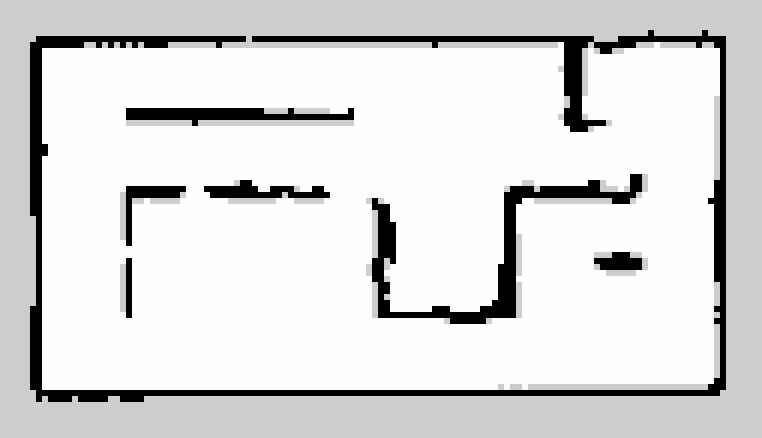
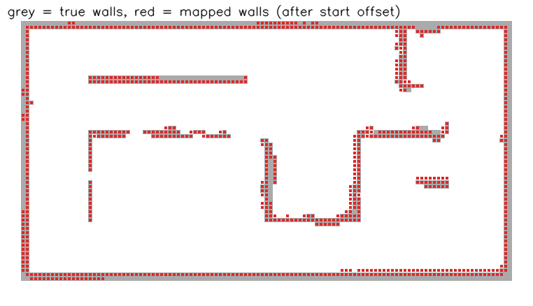
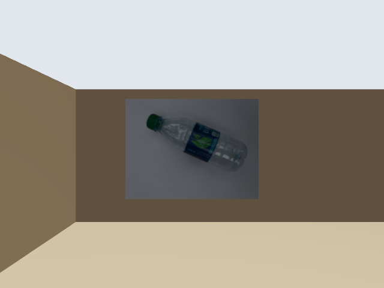
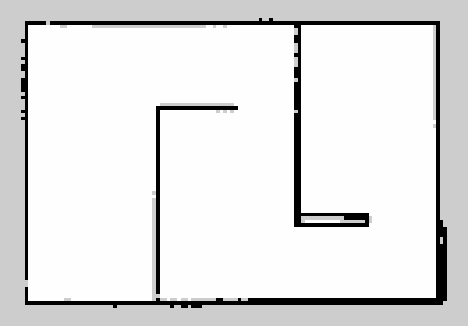
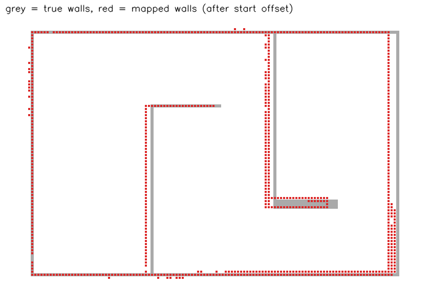

# Virtual SLAM simulation - evidence

**What this is:** results of the team's real software stack (Cartographer, Nav2, the mission node, the same launch files used
on the robot with `sim:=true`) running against a simulated copy of the course in Gazebo Harmonic on a Mac mini. It is a
**simulation, not the real robot**. Every number below was written by a script from the saved result files in this folder, and
every run can be repeated with the commands at the bottom.

## 1. The map the robot built (course)
Built by driving a scripted route through the whole arena, including the dirt-ramp side, then saving the map.



Overlay on the true walls (grey = true walls from the Gazebo world, red = walls the robot mapped):



## 2. The robot's camera sees the screen
Frame from the simulated Pi camera (640x480): the screen shows a plastic-bottle photo from our own test photos.



## 3. A different world (maze) - works there too
 

## 4. Numbers (generated by `scripts/sim/summarize.py`)
### Map accuracy vs ground truth

| map | wall error mean (raw) | p95 | after best rigid fit (mean / p95, shift) | true walls covered <10 cm | free-space box (map vs truth) |
|---|---|---|---|---|---|
| course | 0.6 cm | 5.0 cm | 0.6 / 5.0 cm (0.0, 0.0 cm, 0.0 deg) | 99.6 % | 5.65 x 2.90 vs 5.65 x 2.90 m |
| maze (unrelated world) | 5.1 cm | 15.0 cm | 2.7 / 10.0 cm (6.7, 2.0 cm, -0.2 deg) | 90.2 % | 5.75 x 3.90 vs 5.90 x 3.90 m |

### Nav2 goals on the saved map (truth-scored)

| run | goals reached | mean loc. error at goal | worst loc. error | standing-still recovery |
|---|---|---|---|---|
| course, 8 goals | 8/8 | 3.2 cm | 6 cm | - |
| maze, 6 goals | 6/6 | 6.6 cm | 14 cm | - |
| course + teleport 5 m, default stack | 4/4 | 3.2 cm | 501 cm | not recovered in 90 s |
| course + teleport 5 m, loc_v2 + apply_corrections | 4/4 | 10.4 cm | 15 cm | 26.2 s |

### Mission rehearsal (real mission node, stub classifier, phase 2 on the saved map)

| case | gate seen (median ahead) | decision | waited | mission finished at |
|---|---|---|---|---|
| closed_worker | - | - | - | did not finish |
| gate_closed | 0.99 m | path1 | 5.05 s | 142.6 s |
| gate_open | 3.79 m | path2 | 0.4 s | 114.1 s |
| gate_timed2 | 3.79 m | path2 | 1.81 s | 115.4 s |
| open_worker | 3.78 m | path2 | 0.41 s | 134.6 s |
| ramps | 3.82 m | path2 | 0.4 s | 121.4 s |

Notes: "loc. error" = distance between Cartographer's pose and the simulator's true pose. "Raw" error uses only the known start
offset; the rigid fit shows how much is a global shift. Teleport test: the robot is picked up and moved 5 m mid-run.
Raw data: `*_accuracy.json`, `nav_*.json`, `recovery_*.json`, `rehearsal_*_mission_events.txt` (the mission node's own log, with
its gate decision and finish time). Camera/lidar/IMU recordings (rosbag) are kept locally, not in git.

## 5. Limits (honest)
- Simulated lidar/IMU/camera and a placeholder arena (back corridors, ramps, gate, bins are estimates; see `SIM_MEASUREMENTS_NEEDED.md`).
- The truth map is the world the simulator was generated from, so the accuracy numbers say the *algorithms* work on this geometry,
  not that the real course will give the same figures.
- Some rows were measured before the robot model changed from 2 to 4 wheels; see `SIM_REPORT.md`.

## Reproduce (Mac, from the repo root)
```
pixi run bash scripts/sim/mapping_demo.sh course mapping_course
pixi run python scripts/sim/accuracy_report.py docs/sim_demo/mapping_course.yaml
pixi run bash scripts/sim/localization_demo.sh course docs/sim_demo/mapping_course.pbstream
pixi run bash scripts/sim/mission_demo.sh my_run gate=timed:2
```
Full instructions: `RUNBOOK.md` ("Virtual SLAM simulation").
