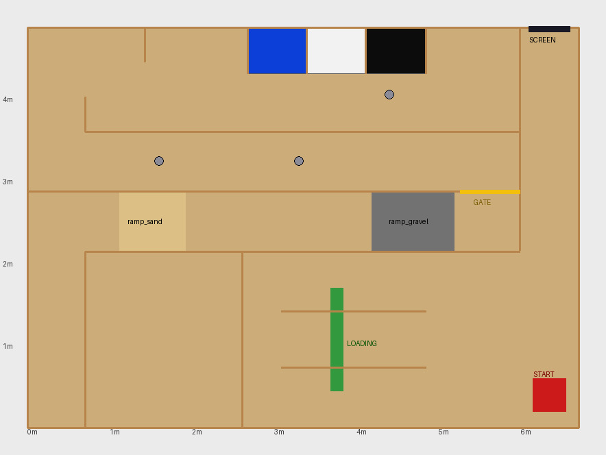

# rdj2026_sim — virtual Robotics Dojo 2026 game field

A Gazebo (Ignition) **Fortress** + **ROS 2 Humble** simulation of the RDJ 2026 game field with a
simulated *hardleel*, for practising the mapping phase, Nav2, the gate decision and the
**Virtual SLAM** assessment (rulebook §7g, 10 points).

Humble + Fortress is the stack Robotics Dojo uses in its own simulation material
([GAMEFIELD-2025](https://github.com/roboticsdojo/GAMEFIELD-2025),
[gazebo_ignition_fortress](https://github.com/roboticsdojo/gazebo_ignition_fortress)).



## What's in the field

| Feature (rulebook) | In the simulation |
|---|---|
| 6703.56 × 4868 mm field, corridors (Fig. 1) | `field_walls`, 30 cm high |
| Colour-coded offloading zones — blue/white/black | three 560 mm bays on the top wall |
| Loading zone (3 stations) | green table + plastic/metal/organic slots |
| Ramp + sand, ramp + gravel | two 6 cm ramps (LiDAR sees over them, like the real ones) |
| Time-based dynamic barrier (Path 2 gate) | yellow `gate`, opened/closed at random by `gate_controller.py` |
| Cylinders placed by judges | three 110 mm cylinders |
| Display screen (waste detection) | dark panel, top-right |
| Start position | red pad, bottom-right |

Everything comes from **`arena/arena_layout.yaml`** (millimetres). Items marked `GUESS` there are
interpretations of the low-resolution rulebook drawing — correct them after inspecting the real
field and regenerate:

```bash
python3 arena/generate_arena.py     # rewrites worlds/, maps/rdj2026_truth.*, arena/preview.png
```

## The simulated robot

Same frames and topics as the real hardleel, so the robot's Cartographer config is reused unchanged:
`base_link → laser` (z 0.15, yaw 0) publishing `/scan` at 5.5 Hz, `base_link → imu_link` publishing
`/imu/data_raw` at 100 Hz, `/cmd_vel` in. The difference: Gazebo's diff-drive plugin provides
`odom → base_link` (the real robot gets it from the IMU EKF).

## Install (Ubuntu 22.04 / WSL2 with ROS 2 Humble)

```bash
sudo apt install ros-humble-ros-gz ros-humble-cartographer-ros ros-humble-slam-toolbox \
                 ros-humble-navigation2 ros-humble-nav2-bringup ros-humble-teleop-twist-keyboard
cd ~/ros2_ws && colcon build --symlink-install --packages-select rdj2026_sim
source install/setup.bash
```

On WSL without a GPU, `export LIBGL_ALWAYS_SOFTWARE=1` (or use `gui:=false`).

## Use

```bash
# 1. field + robot (gate starts cycling after ~8 s)
ros2 launch rdj2026_sim sim.launch.py
# 2. mapping practice - Cartographer (default) or slam_toolbox
ros2 launch rdj2026_sim mapping.launch.py            # slam:=slam_toolbox
ros2 run teleop_twist_keyboard teleop_twist_keyboard
ros2 run nav2_map_server map_saver_cli -f ~/maps/sim_map
# 3. navigation practice - on the ground-truth map or your own
ros2 launch rdj2026_sim nav.launch.py                # map:=$HOME/maps/sim_map.yaml
```

`/gate_open` (std_msgs/Bool) shows the true gate state, so you can check your robot's gate
decision — the robot itself should detect the gate with the LiDAR.

`maps/rdj2026_truth.yaml` is a perfect map of the fixed walls and fixtures; compare your SLAM map
against it to judge completeness and accuracy, the same things the judges score.
