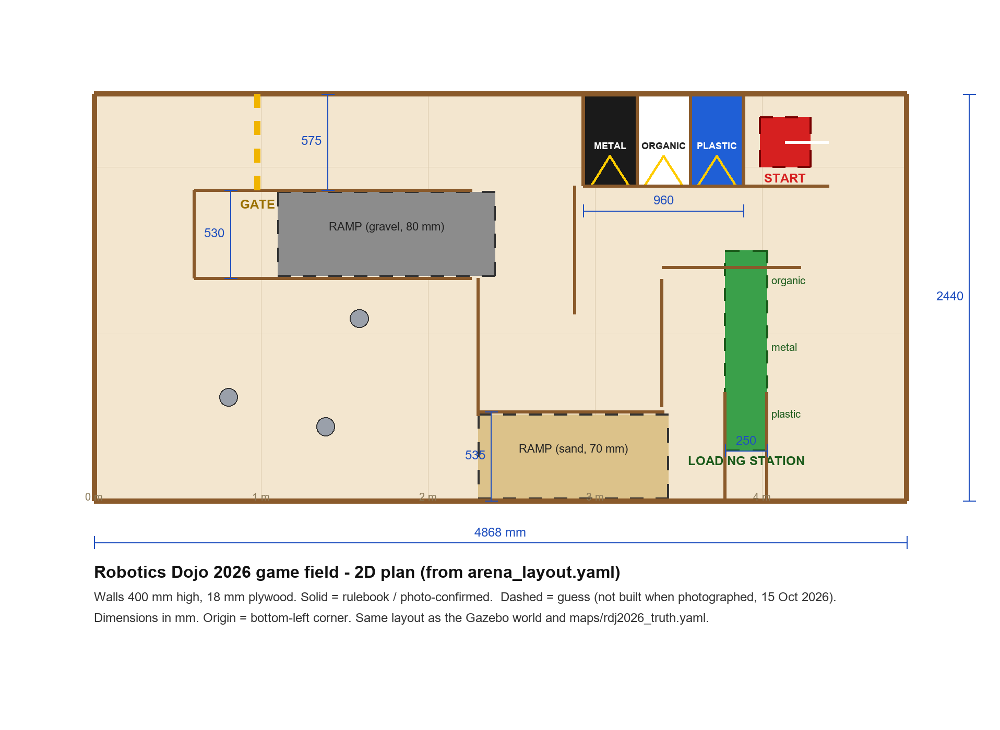

# rdj2026_sim — virtual Robotics Dojo 2026 game field

A Gazebo (Ignition) **Fortress** + **ROS 2 Humble** simulation of the RDJ 2026 game field with a
simulated *hardleel*, for practising the mapping phase, Nav2, the gate decision and the
**Virtual SLAM** assessment (rulebook §7g, 10 points).

Humble + Fortress is the stack Robotics Dojo uses in its own simulation material
([GAMEFIELD-2025](https://github.com/roboticsdojo/GAMEFIELD-2025),
[gazebo_ignition_fortress](https://github.com/roboticsdojo/gazebo_ignition_fortress)).



**2D plan:** `arena/plan_2d.svg` (vector, for printing / the poster) and `arena/plan_2d.png`, with dimensions
and every zone; dashed = still a guess. Regenerate with `python3 arena/draw_plan.py`.
For Nav2 the matching 2D occupancy map is `maps/rdj2026_truth.yaml`.

## What's in the field

The course follows the rulebook's **course drawing (Figure 2)**, converted to a floor plan with a calibrated
inverse isometric projection and checked by overlaying a render from the same camera on Figure 2
(`arena/figure2_overlay.png`). Field **4868 x 2440 mm**; walls 400 mm (from the field photos).
Rulebook Figure 1 (6703 x 4868) is a different, older design - kept in `arena/alternatives/`.

| Figure 2 feature | In the simulation |
|---|---|
| 1 Ramp + sand | 70 mm ramp in the lane along the front wall |
| Ramp + gravel | 80 mm ramp in the middle corridor (closed at its left end) |
| 2 Random time-based dynamic obstacle | `gate` across the back corridor, cycled by `gate_controller.py` |
| 3 Cylinders placed by judges | three 110 mm cylinders in the open room at the left end |
| 4 Loading zone | green board with plastic / metal / organic slots, raised over a slot |
| 5 Colour-coded offloading zones | three bays on the back wall under a V-notched deck (black / white / blue) |
| 6 Start | start box in the back-right corner |

Edit `arena/arena_layout.yaml` (mm) and regenerate:

```bash
python3 arena/generate_arena.py   # Gazebo world + maps/rdj2026_truth.* (Nav2) + preview
python3 arena/draw_plan.py        # 2D plan (svg + png)
python3 arena/render_iso.py       # 3D view from the same camera as Figure 2
```

## The simulated robot

Same frames and topics as the real hardleel, so the robot's Cartographer config is reused unchanged:
`base_link → laser` (z 0.15, yaw 0) publishing `/scan` at 5.5 Hz, `base_link → imu_link` publishing
`/imu/data_raw` at 100 Hz, `/cmd_vel` in. The difference: Gazebo's diff-drive plugin provides
`odom → base_link` (the real robot gets it from the IMU EKF).

## Install (Ubuntu 22.04 / WSL2 with ROS 2 Humble)

```bash
sudo apt install ros-humble-ros-gz ros-humble-cartographer-ros ros-humble-slam-toolbox \
                 ros-humble-navigation2 ros-humble-nav2-bringup ros-humble-teleop-twist-keyboard
cd ~/ros2_ws && colcon build --symlink-install --packages-select rdj2026_sim
source install/setup.bash
```

On WSL without a GPU, `export LIBGL_ALWAYS_SOFTWARE=1` (or use `gui:=false`).

## Use

```bash
# 1. field + robot (gate starts cycling after ~8 s)
ros2 launch rdj2026_sim sim.launch.py
# 2. mapping practice - Cartographer (default) or slam_toolbox
ros2 launch rdj2026_sim mapping.launch.py            # slam:=slam_toolbox
ros2 run teleop_twist_keyboard teleop_twist_keyboard
ros2 run nav2_map_server map_saver_cli -f ~/maps/sim_map
# 3. navigation practice - on the ground-truth map or your own
ros2 launch rdj2026_sim nav.launch.py                # map:=$HOME/maps/sim_map.yaml
```

`/gate_open` (std_msgs/Bool) shows the true gate state, so you can check your robot's gate
decision — the robot itself should detect the gate with the LiDAR.

`maps/rdj2026_truth.yaml` is a perfect map of the fixed walls and fixtures; compare your SLAM map
against it to judge completeness and accuracy, the same things the judges score.
